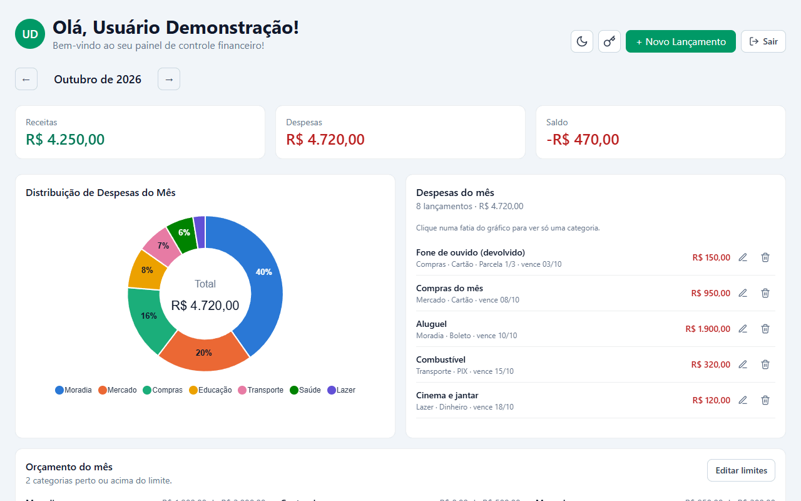
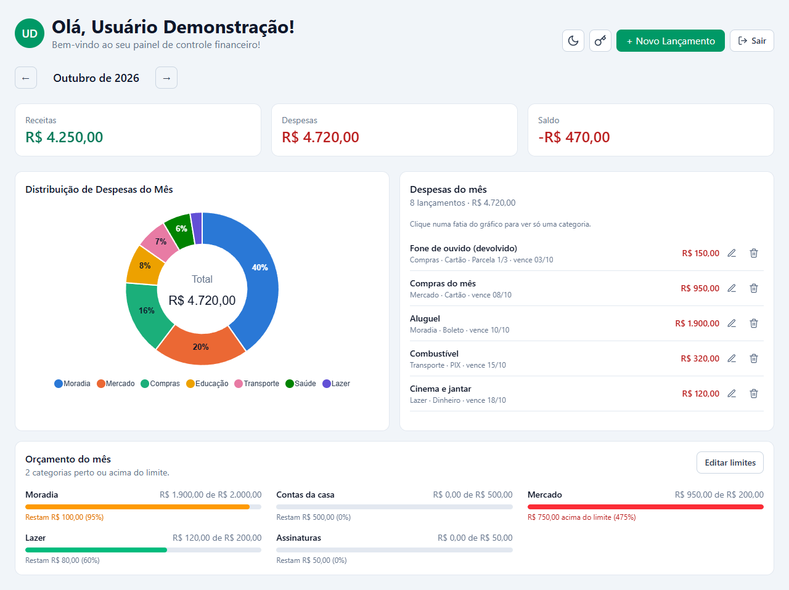
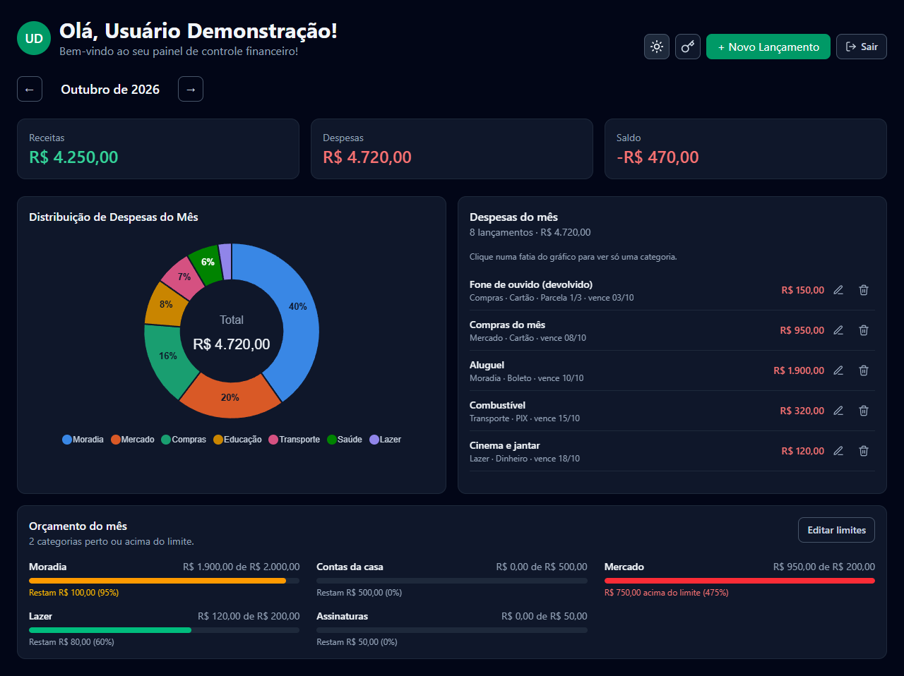
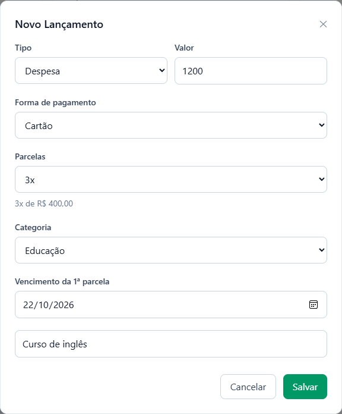
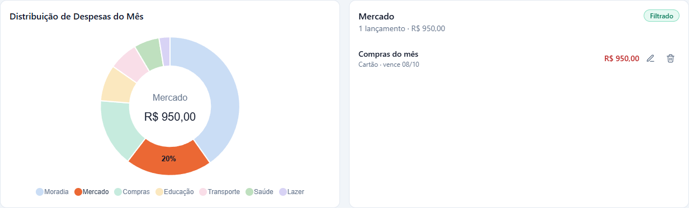
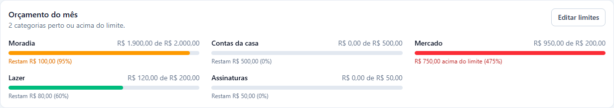
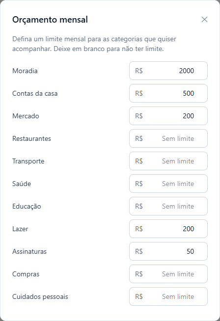
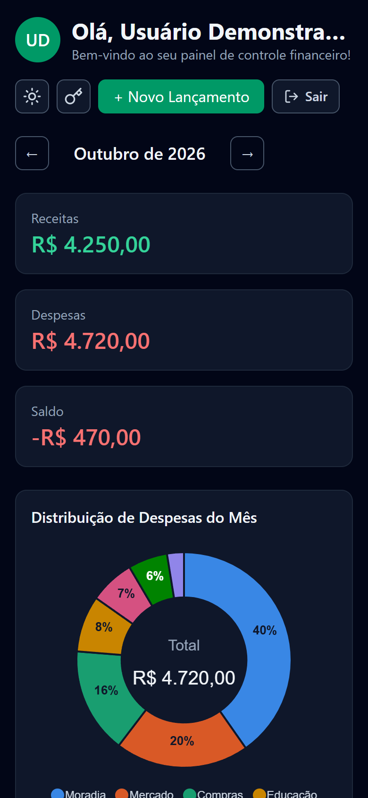

# Expense Control

Aplicação web para controle de gastos pessoais: lançamentos com parcelamento, visão mensal por categoria, orçamento por categoria e autenticação com recuperação de senha sem e-mail.

Este repositório é o **front-end** (Vue 3). A API (Node.js, Fastify e PostgreSQL) está em [expense_control_api](https://github.com/alessonbruh/expense_control_api).



## Telas

| Dashboard | Tema escuro |
|---|---|
|  |  |

| Lançamento parcelado | Filtro por categoria |
|---|---|
|  |  |

| Orçamento do mês | Definir limites |
|---|---|
|  |  |

| Login | Celular |
|---|---|
|  |  |

## Funcionalidades

- **Dashboard mensal**: receitas, despesas e saldo do mês, com navegação entre meses.
- **Lançamentos parcelados**: no cartão, a compra pode ser dividida em até 12x. O formulário mostra a divisão antes de salvar (ex.: "3x de R$ 400,00"), com a mesma regra de centavos da API.
- **Gráfico por categoria**: clicar numa fatia (ou na legenda) filtra a lista de lançamentos do mês. Dá para selecionar várias categorias.
- **Editar e excluir lançamentos** direto da lista.
- **Orçamento por categoria (opcional)**: limite mensal por categoria, com barra verde, amarela (a partir de 80%) ou vermelha (acima do limite).
- **Conta**: cadastro, login, logout e recuperação de senha com códigos de uso único.
- **Tema claro e escuro**, seguindo o sistema por padrão.
- **Responsivo**: funciona no celular sem rolagem horizontal.

## Stack

| | |
|---|---|
| Framework | Vue 3 (Composition API, `<script setup>`) + TypeScript |
| Build | Vite |
| Estilo | Tailwind CSS 4 |
| Rotas | Vue Router |
| Gráficos | ApexCharts (`vue3-apexcharts`) |

## Estrutura

O código é organizado por **módulo** (cada área do app tem suas páginas, componentes, serviços e tipos):

```
src/
├── modules/
│   ├── auth/          # Login, cadastro, recuperação de senha e códigos de recuperação
│   ├── dashboard/     # Página principal, gráfico, lista, orçamento
│   │   ├── components/
│   │   ├── pages/
│   │   └── utils/     # Cálculos do mês e do orçamento (funções puras)
│   ├── expense/       # Serviço e tipos de lançamentos
│   ├── category/      # Serviço e tipos de categorias
│   └── budget/        # Serviço e tipos de orçamento
├── components/        # Componentes reutilizáveis (modal, toasts, formulário de lançamento)
├── composables/       # Estado e lógica compartilhada (tema, toasts, sessão, animações)
├── shared/            # Sessão, enums e utilitários de data, moeda e cor
└── routes/            # Rotas e proteção das páginas autenticadas
```

## Decisões técnicas

### Cálculos em funções puras
O que o dashboard mostra sai de funções sem dependência de Vue, em `modules/dashboard/utils`:
- `summarizeMonth`: totais do mês e fatias do gráfico (as categorias menores são agrupadas em "Outros");
- `budgetProgress`: gasto de cada categoria comparado ao limite.

As duas usam a mesma regra para o valor do mês: soma só as parcelas que vencem no mês, sem as canceladas. Assim, gráfico, lista e orçamento sempre batem entre si.

### Datas sem erro de fuso
A API devolve datas em UTC (`2026-11-10T00:00:00.000Z`). Converter isso com `new Date()` no horário do Brasil mostraria **o dia anterior**. Por isso, as datas de vencimento são lidas pela parte da data da string, e a navegação entre meses usa datas locais.

### Sessão expirada tratada em um só lugar
Quando a API responde `401`, o serviço encerra a sessão e lança um `SessionExpiredError`. O aviso "Sua sessão expirou" aparece **uma única vez**, mesmo quando várias requisições falham ao mesmo tempo, e as telas não mostram um segundo erro por cima.

### Tema com tokens de cor
As cores são variáveis CSS (`--card`, `--ink`, `--line`...) definidas para cada tema em `style.css`, e os componentes usam só esses nomes (`bg-card`, `text-ink`). Trocar o tema troca as variáveis, sem condicionais espalhadas pelos componentes. A escolha fica salva no navegador; sem escolha, o app segue o tema do sistema.

### Animações com respeito à acessibilidade
Os números dos cards e as barras do orçamento são animados, mas as animações são desligadas quando o sistema está com "reduzir movimento" ativado.

### Content-Security-Policy
O token de sessão fica no `localStorage`, que qualquer script da página consegue ler. Por isso o `index.html` declara uma CSP que só permite executar scripts do próprio app e só permite requisições para o próprio app e para a API (`VITE_API_URL`):
- um script injetado na página (XSS) é bloqueado pelo navegador e não chega a ler o token;
- mesmo que algum código malicioso rodasse, ele não conseguiria enviar dados para outro domínio.

Por isso não há nenhum script inline: o tema é aplicado antes da página aparecer por `public/theme-init.js`, um arquivo próprio.

### Recuperação de senha sem e-mail
No cadastro, o app mostra 8 códigos de recuperação, com opções de copiar e baixar, e só deixa continuar depois de o usuário confirmar que os guardou. Com um desses códigos, a senha pode ser redefinida na tela "Esqueceu a senha?". O dashboard avisa quando restam poucos códigos.

## Como rodar

**Pré-requisitos:** Node.js 22+ e a [API](https://github.com/alessonbruh/expense_control_api) rodando (por padrão em `http://localhost:3000`).

```bash
git clone https://github.com/alessonbruh/expense-control-app.git
cd expense-control-app
npm install

cp .env.example .env
npm run dev
```

O app abre em `http://localhost:5173`. A API já vem configurada para aceitar requisições dessa origem.

### Conta de demonstração
Com a API rodando em desenvolvimento, já existe uma conta com dados de exemplo (lançamentos dos últimos meses, compras parceladas e uma compra cancelada):

| E-mail | Senha |
|---|---|
| `demo@example.com` | `demo1234` |

### Variáveis de ambiente

| Variável | Descrição |
|---|---|
| `VITE_API_URL` | Endereço da API (padrão do exemplo: `http://localhost:3000`) |

### Scripts

| Comando | O que faz |
|---|---|
| `npm run dev` | Inicia em modo desenvolvimento |
| `npm run build` | Checa os tipos (`vue-tsc`) e gera a versão de produção em `dist/` |
| `npm run preview` | Serve a versão de produção localmente |
